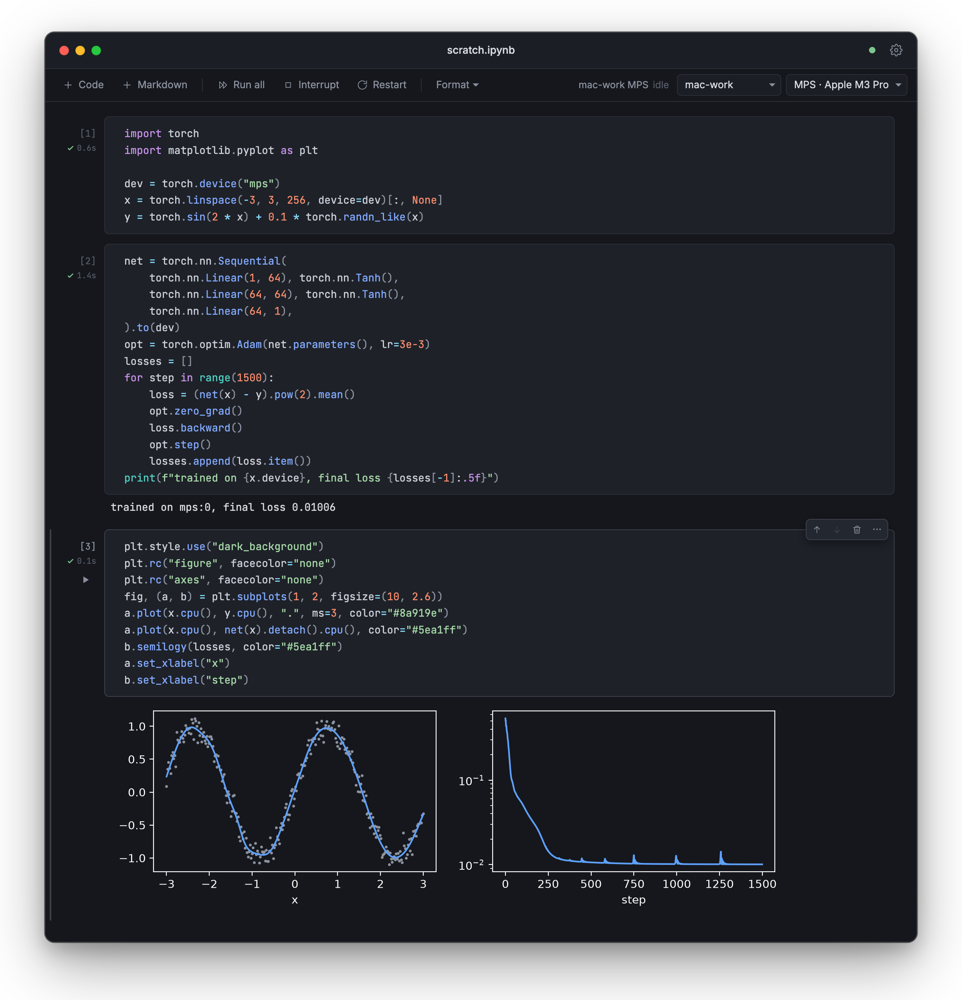
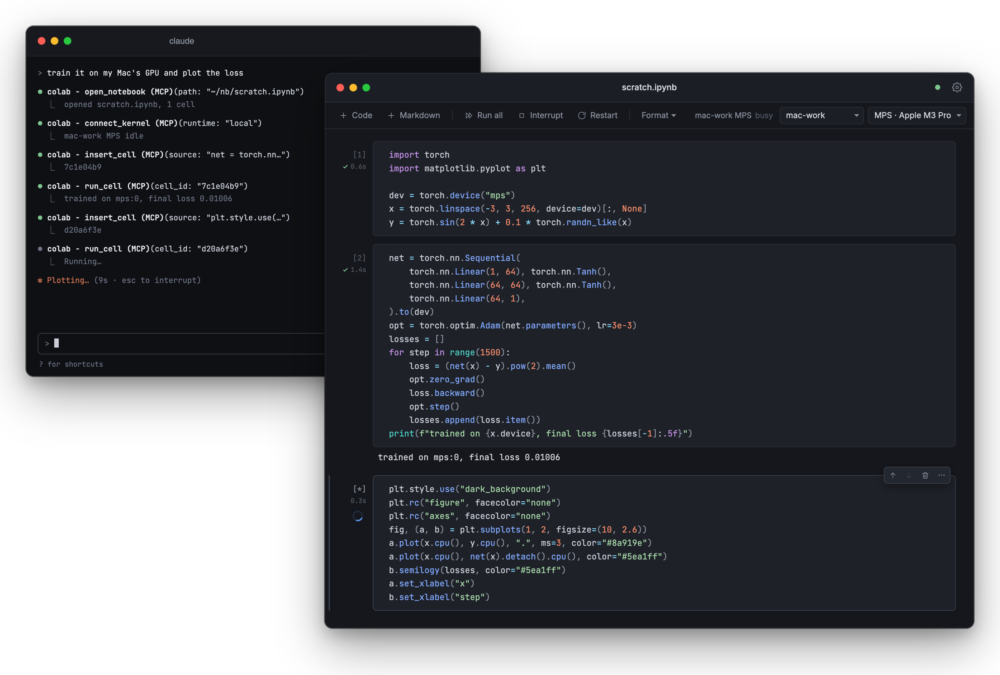

<h1 align="center">Colab Notebook</h1>

<p align="center">Jupyter notebooks in a native Mac app, on any kernel.</p>

<p align="center">
  <a href="https://github.com/priyanshujain/colab-app/releases/latest">Download</a>
  ·
  <a href="https://priyanshujain.github.io/colab-app/">Website</a>
</p>

<p align="center">
  
</p>

Colab Notebook is a macOS app for Jupyter notebooks. Your `.ipynb` files stay on your disk, and you pick where each one runs: this Mac (Apple Silicon MPS), a Google Colab runtime (CPU, T4, L4, A100 or TPU), or another of your machines. The editor has ruff and ty built in, saves as you type, and merges outside edits live.

A headless server keeps notebooks and kernels running with no window open. Your machines connect over built-in Tailscale. A notebook on one machine can run on another machine's kernel, for example a notebook on a Linux box on the Mac's MPS kernel, next to Colab.

Agents drive it over MCP, locally or on a remote machine.

<p align="center">
  
</p>

## Install

Download the DMG from the [latest release](https://github.com/priyanshujain/colab-app/releases/latest) and drag the app to Applications. It needs an Apple Silicon Mac.

To use it from Claude Code, register the MCP server:

```sh
claude mcp add --scope user colab -- "/Applications/Colab Notebook.app/Contents/MacOS/colab-app" mcp
```

Then copy the skill in [skills/colab-notebook](skills/colab-notebook/SKILL.md) to `~/.claude/skills/`.

## Build from source

You need Go and Rust.

```sh
just install
just test
```

## Note

This project is not affiliated with, endorsed by or made by Google. It is an independent open source app. It runs Jupyter notebooks on any kernel, and Google Colab is one of the runtimes it supports, not the whole app. The name and logo may change in the future.
