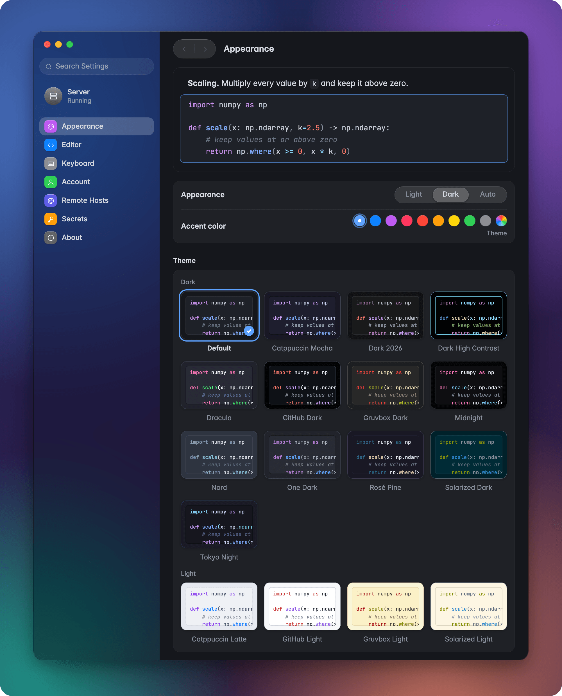
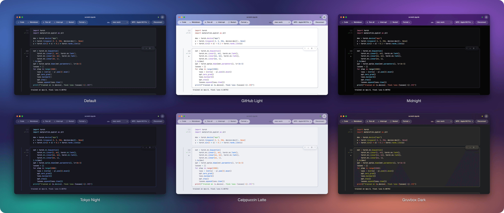

# Appearance

Version 0.1.10 added themes, a light mode, accent colors and a translucent window. All of it lives in **Settings > Appearance**. A preview at the top shows each change at once.

*Settings > Appearance with the preview, the accent swatches and the theme grid.*

## The Settings window

Settings opens in its own window. Press <kbd>⌘</kbd><kbd>,</kbd>, click the gear in a notebook title bar, or pick **Settings...** in the menu bar icon. There is only one Settings window. A second request brings it to the front.

The sidebar lists the sections: Server, Appearance, Editor, Keyboard, Account, Remote Hosts, Secrets and About. The search field filters the sections by keyword. Back and forward buttons move through the sections that you visited.

A change applies to every open window at once. There is no Save button.

## Light, dark and auto

**Appearance** has three choices. **Dark** is the default.

| Choice | Theme in use |
|---|---|
| Light | The light theme that you picked. The default is GitHub Light. |
| Dark | The dark theme that you picked. The default is Default. |
| Auto | Follows macOS. The dark theme in dark mode, the light theme in light mode. |

The app also sets the macOS appearance of the window, so the title bar and menus match the theme. With Auto, macOS decides.

## Themes

The theme grid has a Dark group and a Light group. You keep one dark choice and one light choice. When Appearance is Light or Dark, a click on a theme of the other group also switches Appearance.

| Group | Themes |
|---|---|
| Dark | Default, Catppuccin Mocha, Dark 2026, Dark High Contrast, Dracula, GitHub Dark, Gruvbox Dark, Midnight, Nord, One Dark, Rosé Pine, Solarized Dark, Tokyo Night |
| Light | Catppuccin Latte, GitHub Light, Gruvbox Light, Solarized Light |

*One notebook in six of the seventeen themes.*

A theme colors the window, the editor, syntax tokens, diagnostics, outputs and the 16 ANSI colors of text output.

### Accent color

**Accent color** replaces the accent of the theme. The swatches are Theme, Blue, Purple, Pink, Red, Orange, Yellow, Green and Graphite. The last well opens a color picker for any color. Theme keeps the accent of the theme. The app picks black or white button text for the best contrast with your accent.

## Translucent window

The notebook and Settings windows use the macOS Liquid Glass material. The desktop shows through the sidebar and the title bar. **Window > Translucent window** turns it on or off. It is on by default.

When it is on, **Content opacity** sets how much of the background color the content area keeps, from 60% to 100%. At 100% only the chrome is translucent.

The app turns the effect off when **Reduce transparency** is on in the macOS accessibility settings. The window section shows only on a Mac.

## Layout

| Setting | Range | Default |
|---|---|---|
| Notebook padding | 0 to 48 px, in steps of 4 | 12 px |
| Corner radius | 0 to 16 px | 8 px |

## Fonts

Each font row has a font menu and a size control. The code font menu lists only the monospace fonts on your Mac.

| Row | Default | Size range |
|---|---|---|
| Interface | Inter, 13 | 10 to 20 |
| Markdown | Inter, 14 | 10 to 28 |
| Code | JetBrains Mono, 13 | 8 to 32 |

Font ligatures, line height and tab size are in **Settings > Editor**. The [Settings reference](settings.md) lists them all.

## How themes work inside

Each theme is a TypeScript file in `ui/src/lib/themes/`. Most themes give a small palette to the `fromPalette` helper in `ui/src/lib/palette.ts`. The helper turns the palette into about 80 CSS variables. The app sets them on the root element.

A new file in that folder is a new theme. The theme index loads every file in the folder, so no list needs an edit. Default comes first, then dark themes, then light themes, each by name.
