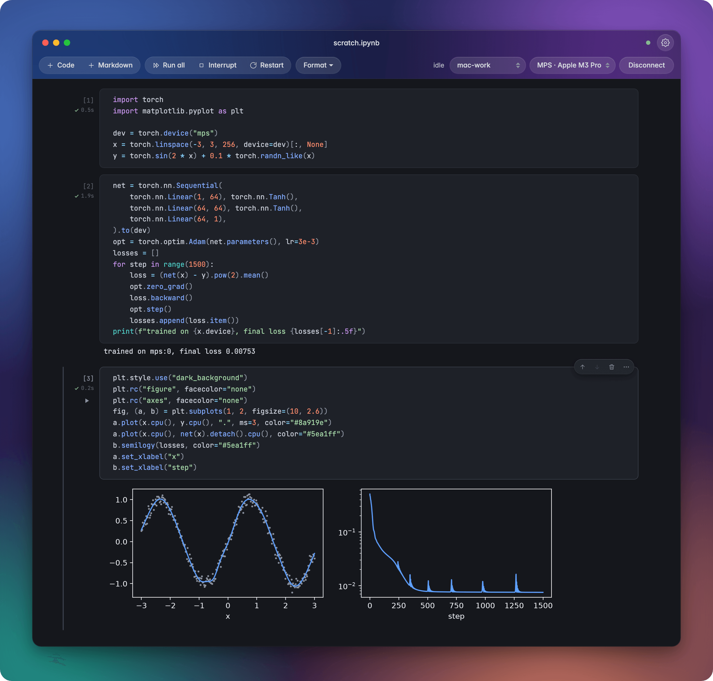

# Installation

Colab Notebook is a native Mac app for Jupyter notebooks. Your `.ipynb` files stay on your disk. You pick where each notebook runs: this Mac, a Google Colab runtime, or another of your machines.



The app has two parts. The Mac app is the window that you see. `colab-server` owns the notebooks and kernels, and it also runs headless on Linux.

## macOS

The app needs an Apple Silicon Mac.

1. Download the DMG from the [latest release](https://github.com/priyanshujain/colab-app/releases/latest). The file is `Colab-Notebook-<version>-aarch64.dmg`.
1. Open it and drag **Colab Notebook** to **Applications**.
1. Open the app. It is signed and notarized, so macOS opens it without a warning.

At first start the app also starts its server in the background. The server downloads pinned builds of uv, ty and ruff into its data folder. It checks each download against a SHA-256 checksum. See [Managed binaries](language-tooling.md#managed-binaries).

## Install with an agent

Claude Code can do the whole install for you. Paste this prompt into a Claude Code session on the Mac:

```text
Fetch https://raw.githubusercontent.com/priyanshujain/colab-app/main/skills/install-colab-notebook/SKILL.md and follow it to install Colab Notebook on this Mac.
```

The agent installs the app, registers the MCP server and installs the notebook skill. It asks before it replaces an existing install. The [Skills](skills.md) page shows the full text of each skill.

## Linux (server only)

On Linux you run `colab-server` without a window. Your Mac opens its notebooks, or uses its kernels, over Tailscale. The build needs Rust and Go.

```sh
cargo build --release -p colab-server
cp target/release/colab-server ~/.local/bin/
colab-server run
```

Leave it running. In a second terminal, turn on Tailscale:

```sh
colab-server tailscale on
```

`colab-server tailscale on` prints a sign in link. [Remote Hosts](remote-hosts.md) shows the systemd unit, the host setup and the security rules.

## Build from source

You need Rust, Go, Node.js with npm and `just`. Then run:

```sh
just install
```

[Building and Releasing](building.md) has the details.

## First steps

1. Open a notebook with **File > Open...** (<kbd>⌘</kbd><kbd>O</kbd>), or clone one with **File > Clone from Colab...**. The app has no New Notebook command.
1. Pick a place in the kernel bar and press **Connect**. For this Mac, the server creates the project `.venv` with uv if it is missing. See [Kernels](kernels.md).
1. Press <kbd>⇧</kbd><kbd>↩</kbd> to run a cell and move on. You never save by hand: the server writes the file one second after the first unsaved change.
1. To use Colab, open **Settings** (<kbd>⌘</kbd><kbd>,</kbd>), go to **Account** and press **Sign in with Google**. If you use Google's Colab CLI, the app reuses its token.
1. To use the app from Claude Code, follow [Agents](agents-mcp.md).

> The app uses the OAuth client of Google's open source Colab CLI. If Google rejects that client, **Settings > Account** accepts your own client id and secret.

## About this project

Colab Notebook is open source under the Apache 2.0 license. The source is at [github.com/priyanshujain/colab-app](https://github.com/priyanshujain/colab-app).

This project is not affiliated with, endorsed by or made by Google. It is an independent open source app. It runs Jupyter notebooks on any kernel, and Google Colab is one of the runtimes it supports, not the whole app. The name and logo may change in the future.
